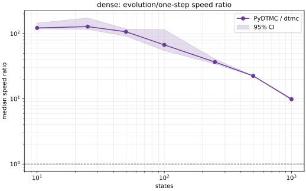
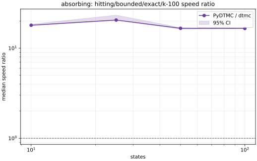
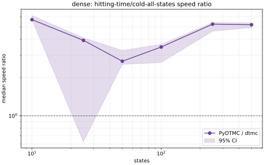
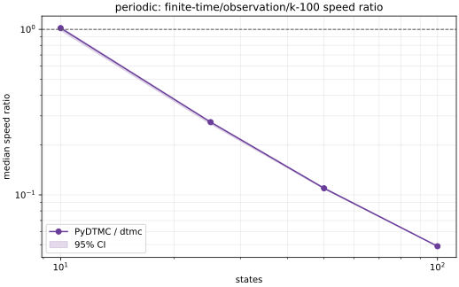

# Benchmark report: dtmc versus PyDTMC 9.0.0

## Result

The full benchmark completed successfully on 14 September 2026. It compares
equivalent public-API workloads in dtmc and PyDTMC 9.0.0 on the same generated
transition matrices.

Across 932 family-size-operation aggregates:

- 917 aggregates (98.4%) have a median ratio above one and therefore favour
  dtmc.
- 913 aggregates (98.0%) have a complete 95% seed-bootstrap interval above
  one.
- 13 aggregates (1.4%) have a complete interval below one and favour PyDTMC.
- 6 aggregates (0.6%) have an interval that crosses one and are inconclusive.
- The unweighted median ratio across all aggregates is 14.52.

The ratio is:

~~~text
PyDTMC elapsed time / dtmc elapsed time
~~~

A ratio of 14.52 means that PyDTMC took 14.52 times as long as dtmc for that
benchmark case. Ratios below one favour PyDTMC. The overall median gives every
family-size-operation aggregate equal weight. It is a summary of this
benchmark suite, not a prediction that every dtmc operation is 14.52 times
faster.

The source of truth for these results is
[results/ratio-summary.csv](results/ratio-summary.csv). It contains one
aggregate for each family, size, and operation, calculated from three fixture
seeds. The underlying 2,796 seed-level ratios are in
[results/ratios.csv](results/ratios.csv).

## Results by operation group

“Clear” means that the complete bootstrap interval across the three fixture
seeds lies on one side of one. “Inconclusive” means that it crosses one.

| Operation group | Aggregates | Median ratio | Clear dtmc wins | Clear PyDTMC wins | Inconclusive |
|---|---:|---:|---:|---:|---:|
| Absorption probabilities | 6 | 9.47 | 6 | 0 | 0 |
| Absorption time | 6 | 7.92 | 6 | 0 | 0 |
| Bounded hitting | 120 | 16.34 | 120 | 0 | 0 |
| Bounded return | 40 | 16.76 | 40 | 0 | 0 |
| Bounded visits | 40 | 3.85 | 40 | 0 | 0 |
| Construction | 35 | 16.94 | 35 | 0 | 0 |
| Evolution | 105 | 20.03 | 103 | 0 | 2 |
| Eventual hitting probability | 30 | 2.62 | 29 | 0 | 1 |
| Expected hitting time | 30 | 5.23 | 29 | 0 | 1 |
| Finite-time analysis | 100 | 9.51 | 92 | 6 | 2 |
| Fundamental matrix | 6 | 5.56 | 6 | 0 | 0 |
| Matrix power | 90 | 25.80 | 90 | 0 | 0 |
| Mean recurrence time | 12 | 20.83 | 12 | 0 | 0 |
| Occupation matrix | 10 | 26.49 | 10 | 0 | 0 |
| Race probability | 12 | 15.50 | 12 | 0 | 0 |
| Simulation | 28 | 12.93 | 28 | 0 | 0 |
| Stationary distributions | 30 | 11.94 | 28 | 2 | 0 |
| Structure | 232 | 18.60 | 227 | 5 | 0 |

The recently optimised bounded-hitting, bounded-return, bounded-visit,
absorption-probability, and mean-recurrence paths all have clear wins in every
aggregate included in the full run.

## Representative plots

The plots report the median PyDTMC/dtmc runtime ratio across three fixture
seeds. Values above one favour dtmc, values below one favour PyDTMC, and the
shaded region is the 95% seed-bootstrap interval.

### Dense one-step evolution

### Exact bounded hitting at 100 steps

### Dense expected hitting time

### Known exception: periodic observations at 100 steps

## Cases that favour PyDTMC

The 13 clear PyDTMC wins are concentrated in three behaviours.

### Periodic finite-time observations

The full-initial-distribution observation path is slower on deterministic
periodic chains at sizes 25, 50, and 100.

| Operation | Size | Ratio | Equivalent PyDTMC advantage |
|---|---:|---:|---:|
| finite-time/observation/k-10 | 25 | 0.601 | 1.66 times faster |
| finite-time/observation/k-10 | 50 | 0.286 | 3.50 times faster |
| finite-time/observation/k-10 | 100 | 0.138 | 7.26 times faster |
| finite-time/observation/k-100 | 25 | 0.275 | 3.64 times faster |
| finite-time/observation/k-100 | 50 | 0.110 | 9.12 times faster |
| finite-time/observation/k-100 | 100 | 0.049 | 20.44 times faster |

This weakness is specific to timed observations from the complete initial
distribution. The scalar finite-time/n-step comparisons are clear dtmc wins
in all 40 aggregates.

### Warm cyclic-class access

Five periodic warm-access aggregates favour PyDTMC:

| Sizes | Ratio range | Equivalent PyDTMC advantage |
|---|---:|---:|
| 50, 100, 250, 500, and 1000 | 0.890–0.949 | 1.05–1.12 times faster |

The difference is small but consistent across the three seeds. Cold cyclic
decomposition strongly favours dtmc, so this result concerns repeated access
to an already-computed value rather than the decomposition algorithm.

### Stationary distributions

Two 500-state stationary cases favour PyDTMC:

| Family | Ratio | Equivalent PyDTMC advantage |
|---|---:|---:|
| Periodic | 0.920 | 1.09 times faster |
| Low-outdegree | 0.934 | 1.07 times faster |

These are narrow losses. The other 28 stationary aggregates clearly favour
dtmc.

## Inconclusive cases

Six intervals cross one:

| Family | Size | Operation | Median ratio | 95% interval |
|---|---:|---|---:|---:|
| Absorbing | 1000 | evolution/k-100 | 0.888 | 0.886–1.081 |
| Low-outdegree | 1000 | evolution/k-100 | 0.968 | 0.924–1.084 |
| Periodic | 10 | finite-time/observation/k-100 | 1.018 | 0.984–1.033 |
| Dense | 25 | finite-time/step | 2.998 | 0.465–3.861 |
| Dense | 25 | hitting-probability/cold-all-states | 1.753 | 0.768–2.081 |
| Dense | 25 | hitting-time/cold-all-states | 3.920 | 0.626–4.101 |

The median direction alone should not be used to declare a winner in these
cases.

## Scaling

Fifty-two family-operation combinations occur at every tested size. Holding
this panel constant avoids comparing a different mixture of operations at
each size.

| States | Median ratio in common panel | Aggregates favouring dtmc |
|---:|---:|---:|
| 10 | 27.34 | 52 of 52 |
| 25 | 23.72 | 52 of 52 |
| 50 | 18.20 | 51 of 52 |
| 100 | 15.22 | 51 of 52 |
| 250 | 12.81 | 51 of 52 |
| 500 | 11.28 | 51 of 52 |
| 1000 | 9.70 | 49 of 52 |

dtmc remains faster in nearly every common-panel aggregate at 1000 states,
but its relative advantage generally narrows as the matrices grow.

The log-log fits in [results/scaling.csv](results/scaling.csv) contain 172
operation-family pairs with both engines present. The fitted dtmc exponent is
higher in 135 pairs and lower in 37. These finite-range empirical fits are not
proofs of asymptotic complexity. They do indicate that several dtmc paths grow
faster over the tested size range even though they retain a lower absolute
runtime.

Large-input scaling is therefore a more important optimisation target than
small-operation overhead. The clearest candidates are long evolution,
stationary distributions, and the periodic finite-time observation path.

## Correctness

[results/verification.json](results/verification.json) reports:

- 1,392 successful output comparisons;
- zero failed comparisons;
- a maximum absolute discrepancy of 7.276e-11; and
- configured tolerances of atol=1e-10 and rtol=1e-8.

One near-zero bounded-hitting result has a maximum relative discrepancy of
one, but its absolute discrepancy is only 1.542e-20; it passes the stated
absolute tolerance.

Verification checks complete deterministic outputs through 100 states. The 45
datasets at sizes 250, 500, and 1000 are intentionally skipped by the
verification-size cap. Their timing measurements are present, but this run
does not provide the same element-by-element correctness check at those
sizes.

## Benchmark scope and method

The full run uses:

- five chain families: dense, low-outdegree, absorbing, reducible, and
  periodic;
- sizes 10, 25, 50, 100, 250, 500, and 1000;
- deterministic seeds 1729, 2718, and 31415;
- symmetric size caps for cubic, occupation-matrix, and bounded-horizon
  operations; and
- public end-to-end operations that return equivalent mathematical results.

Both implementations read identical binary fixtures, and input decoding is
outside the timed operation. Finite matrices use dense storage in both
libraries. The low-outdegree family tests matrices containing many exact
zeros, not a sparse-storage representation.

Pyperf records 30 fresh values per normal PyDTMC cell. Criterion uses its
calibrated sampling schedule for dtmc. Each engine's median runtime is first
calculated for each concrete dataset. Seed-level ratios are then grouped by
family, size, and operation. The reported 95% intervals bootstrap the three
seed-level log ratios. They measure variation across those three fixtures;
they do not measure variation across machines or separate overnight runs.

Some equivalent workloads require documented adapters. Examples include
summing PyDTMC first-passage masses for bounded return, aligning its reward
horizon for bounded visits, and making bounded-hitting targets absorbing
outside the timed region. These mappings are part of the benchmark's fairness
contract and are documented in [README.md](README.md).

## Environment

[results/environment.json](results/environment.json) records:

- commit daf5d56d8b7967ced2274dfee0c73f2bacb997ff;
- Apple M1, arm64;
- macOS 15.6.1;
- GHC 9.10.3;
- optimisation flag -O2, with -threaded and -rtsopts;
- Python 3.13.9;
- PyDTMC 9.0.0;
- NumPy 2.3.1 and SciPy 1.16.1;
- Apple Accelerate BLAS and LAPACK for both engines; and
- single-thread limits for BLAS-related runtimes.

The working tree contained only untracked benchmark logs and backups when the
environment was captured.

The benchmark documentation specifies Python 3.12, but this run used Python
3.13.9. This does not invalidate a same-machine comparison in which both
engines use the recorded environment. A publication-oriented reproducibility
run should use the documented Python version or update and justify the
requirement.

## Limits on interpretation

The results support a claim that dtmc is faster for almost all tested
public-API workloads on this Apple M1 configuration. They do not establish:

- identical speedups on Linux, x86-64, or different BLAS implementations;
- a general Haskell-versus-Python language result;
- sparse-matrix performance;
- correctness above 100 states with the same verification coverage;
- performance for operations without equivalent PyDTMC APIs; or
- one universal speedup applicable to every user workload.

The largest ratios occur in cold structural operations and should not be
presented as typical speedups for the entire library. The 14.52 median is less
sensitive to those large outliers, but it still reflects the operation mix in
this suite.

## Recommended next work

1. Profile finite-time/observation on deterministic periodic chains. Its
   disadvantage increases sharply with both size and horizon.
2. Profile the 100-step evolution policy at 1000 states. Two families are
   currently inconclusive and the empirical scaling trend favours PyDTMC.
3. Inspect warm cyclic-class access only after the larger finite-time issue.
   Its loss is stable but small.
4. Repeat a focused subset after each optimisation before committing to
   another full run.
5. Run a second full experiment on a quiet Linux x86-64 machine with the
   documented Python version before publishing hardware-independent claims.

## Result files

- [results/ratio-summary.csv](results/ratio-summary.csv): primary three-seed
  comparison.
- [results/ratios.csv](results/ratios.csv): seed-level paired ratios.
- [results/summary.csv](results/summary.csv): per-engine medians, dispersion,
  confidence intervals, and sample counts.
- [results/scaling.csv](results/scaling.csv): empirical log-log scaling fits.
- [results/verification.json](results/verification.json): correctness
  comparisons.
- [results/environment.json](results/environment.json): compiler, packages,
  linkage, flags, commit, and thread controls.
- [results/plots/](results/plots/): selected publication plots.

The remaining 350 generated plots and the raw Criterion and pyperf output
remain local build artefacts and are intentionally ignored to avoid adding
approximately 15 MB of generated charts and much larger raw timing files to
the repository.
